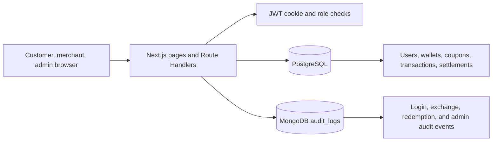

# Digital Coupon Clearinghouse & Loyalty Points Exchange

**Course:** Database Management Systems

**Team:** Sparsha Arun (PES2UG24CS513) and Sri Vaishnavi Peri (PES2UG24CS517).

**Status:** Draft report for the implemented mini project.

## Abstract

The Digital Coupon Clearinghouse & Loyalty Points Exchange is a web application for customers who hold points in multiple merchant loyalty programs. Customers can review wallet balances, preview and perform point exchanges, search and claim coupons, mark claimed coupons as redeemed, and review activity. Merchants manage their coupons and view redemption and settlement summaries. Administrators manage merchants and exchange rates, review audit activity, and pay or cancel completed monthly settlements.

PostgreSQL stores balances and other relational records that must remain consistent. MongoDB stores flexible audit events. The application uses Next.js Route Handlers, parameterized SQL through `pg`, bcrypt password hashes, and JWTs in httpOnly cookies.

## Objectives

- Design a normalized relational database for users, merchants, loyalty programs, wallets, coupons, exchanges, and settlements.
- Prevent negative wallet balances, unauthorized access, duplicate claims, and repeated coupon redemption.
- Keep each exchange and its wallet and settlement updates atomic.
- Demonstrate joins, aggregates, subqueries, full-text search, constraints, views, indexes, triggers, and transaction rollback.
- Use MongoDB for searchable audit events while PostgreSQL remains the source of truth for business balances and settlement totals.

## Functional requirements

| Role | Functions |
|---|---|
| Customer | Register and sign in; view wallets; preview and exchange points; search/filter, claim, and redeem coupons; view activity history. |
| Merchant | View dashboard; create and update its own coupons; review redemptions; view settlements where it owes or is owed. |
| Admin | View platform dashboard and audit events; activate/deactivate merchants; manage exchange rates; review coupons; pay or cancel a settlement after its month closes. |

The backend checks the authenticated user's role for protected writes. Inputs are validated before SQL calls. Database constraints and functions provide a second layer of protection.

## System architecture

The browser calls Next.js Route Handlers. The handlers authenticate and authorize requests, validate inputs, then use parameterized raw SQL through `lib/postgres.js`. PostgreSQL owns the authoritative wallet, coupon, transaction, and settlement data. After successful actions, the application records best-effort audit events in MongoDB; a MongoDB logging outage does not reverse a successful PostgreSQL operation.

## Database choices and design

PostgreSQL is used for structured records with foreign-key relationships and concurrent writes. CHECK, UNIQUE, and foreign-key constraints protect valid states. A stored function locks wallets and performs both balance updates, the transaction insert, and monthly settlement aggregation together. A trigger prevents negative balances and records balance changes. Coupon claim and redemption functions lock rows to prevent overselling claim limits or redeeming the same coupon twice.

MongoDB is used for audit events because event details vary by action and administrators need to filter and aggregate the records. It is not used as the source of truth for wallet balances.

The design has nine core business tables and one supporting balance-audit table. The ER diagram and complete constraints are in [`DB_DESIGN.md`](DB_DESIGN.md).

## Data dictionary

| Table | Purpose and important columns |
|---|---|
| `users` | User accounts: `user_id`, `full_name`, case-insensitive unique `email`, bcrypt `password_hash`, and `role`. |
| `merchants` | Merchant profile linked to a user: `merchant_id`, `user_id`, `business_name`, and active/inactive `status`. |
| `programs` | Loyalty programs: `program_id`, `merchant_id`, `program_name`, `points_name`, and `status`. |
| `wallets` | A customer's points in one program: `wallet_id`, `user_id`, `program_id`, nonnegative `balance`, and `updated_at`. A customer has at most one wallet per program. |
| `coupons` | Merchant offer: `coupon_id`, `merchant_id`, `program_id`, title/description, category, claim limit/count, expiry, status, and redemption instructions. |
| `user_coupons` | Customer coupon claim: `user_coupon_id`, `user_id`, `coupon_id`, status, claim time, and optional redemption time. A unique key blocks duplicate claims. |
| `exchange_rates` | Directional conversion rate: `exchange_rate_id`, source/destination program IDs, positive `rate`, active flag, and update time. |
| `transactions` | Exchange history: customer, source/destination wallets and programs, applied rate, points debited/credited, settlement amount/currency, and timestamp. |
| `settlements` | Monthly total for one debtor/creditor direction and currency: period, amount, status, creator, and optional paid timestamp. |
| `wallet_balance_audit` | Trigger-generated old/new balance values, wallet, optional actor, and change timestamp. |

## Database implementation

The PostgreSQL scripts are in `db/postgres/` and are applied in this order: `schema.sql`, `alter.sql`, `triggers.sql`, `seed.sql`, `functions.sql`, `views_indexes.sql`, and `queries.sql`. Applying `functions.sql` after the sample transaction is inserted lets its idempotent backfill create the corresponding monthly settlement. `reset.sql` is only for intentionally recreating a database. `rollback_demo.sql` demonstrates that changes inside an explicit transaction can be rolled back.

`exchange_points()` locks both wallets in ID order, checks ownership, balance, and the active exchange rate, updates both wallets, writes the transaction, and adds the settlement amount to the monthly total. The destination merchant owes the source merchant. The demo policy is INR 0.10 for each debited source point. Same-merchant exchanges create no settlement.

Settlement rows aggregate by debtor, creditor, calendar month, and currency. They remain pending until the month ends. Admin settlement APIs and a database trigger reject early payment or cancellation. `functions.sql` backfills older cross-merchant transactions idempotently when reapplied.

The SQL layer also includes customer-wallet, coupon-redemption, and settlement-summary views; indexes for common history lookups; and a GIN full-text index for coupon search. The query examples and their explanations are in [`SQL_QUERY_GUIDE.md`](SQL_QUERY_GUIDE.md).

## MongoDB audit model

The `audit_logs` collection stores documents with `eventType`, `timestamp`, `actor` (`userId` and `role`), and action-specific `details`. Events include successful login, points exchanged, coupon redeemed, merchant status changes, coupon changes, exchange-rate changes, and settlement status changes. Indexes support chronological, event-type, and actor lookups. Admin dashboard aggregations summarize events by event type and role; examples are in `db/mongo/aggregations.js`.

Passwords, JWTs, and other credentials are not written to audit events.

## Testing results

The completed test matrix is maintained in [`TEST_RESULTS.md`](TEST_RESULTS.md). It includes authentication, role authorization, merchant/admin actions, customer exchanges, settlement aggregation, exchange-rate management, and MongoDB audit events. A production build completed successfully on the project machine after PR #10; it logged PostgreSQL `ECONNRESET` messages during static generation but still generated the routes and exited successfully. Re-run the build after the current feature-branch changes before merging.

## Screenshots checklist

Capture real screenshots from the running application and place them in the report or the submission's screenshots folder. Do not use seeded rows as proof of an action unless the screenshot shows the relevant state.

- [ ] Sign-in and customer registration.
- [ ] Customer wallets and exchange preview.
- [ ] Successful exchange with refreshed balances and history.
- [ ] Coupon search/filter, claimed state, and redeemed state.
- [ ] Merchant coupon management and redemption list.
- [ ] Merchant settlement summary.
- [ ] Admin dashboard with merchant and coupon status bars.
- [ ] Admin exchange-rate management.
- [ ] Admin settlement status and audit events.
- [ ] PostgreSQL tables/constraints or representative query output.

## Conclusion

The project demonstrates how relational constraints and transactions protect balances, coupon claims, and monthly settlement totals, while MongoDB supports flexible audit reporting. The application connects these database features to role-specific customer, merchant, and administrator workflows. Remaining submission work is to capture the actual screenshots, rerun the production build on the final branch, and review the report and demo materials together.
